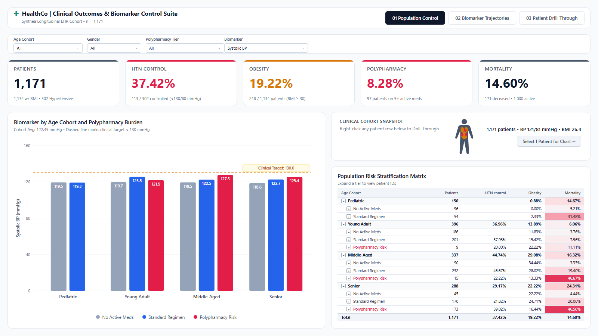
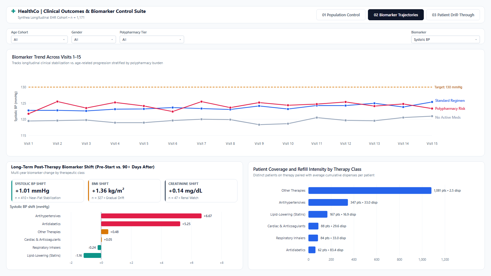
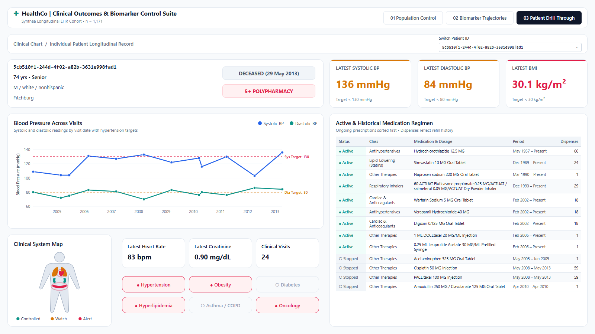
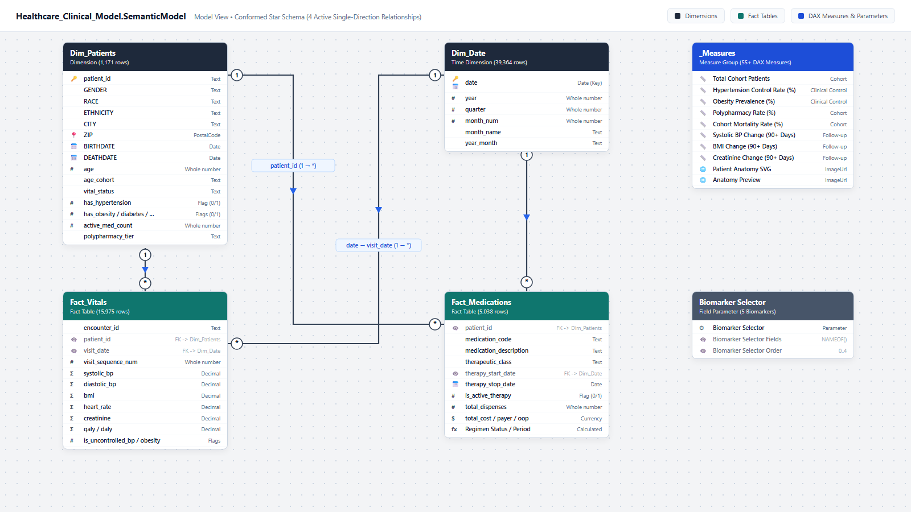

# Clinical Outcomes & Biomarker Control Power BI Suite

> **Project File:** [`Healthcare_Clinical_Model.pbip`](Healthcare_Clinical_Model.pbip) *(Power BI Desktop `.pbip` project with TMDL semantic model & PBIR report definitions)*  
> **Scope:** Synthea Longitudinal EHR Cohort (`n = 1,171` unique Massachusetts patients; `15,975` vital/encounter rows; `5,038` medication prescriptions; `100%` synthetic HIPAA-safe data)  
> **Architecture:** Conformed 4-Table Star Schema • `TOPN` Tie-Breaking DAX • Dynamic Field Parameters • Native DAX SVG Human Anatomy Map (zero custom visual dependencies)

---

## Executive Summary & Live UI Showcase

An end-to-end clinical quality and longitudinal biomarker analytics suite built in **Power BI Project (`.pbip`)** format to evaluate hypertension control, obesity prevalence, polypharmacy burden, multi-visit biomarker trajectories, and within-patient 90+ day post-therapy changes across a **1,171-patient Synthea EHR cohort**.

### 1. Population Control Overview (`01 Population Control`)


### 2. Longitudinal Biomarker Trajectories & Post-Therapy Shift (`02 Biomarker Trajectories`)


### 3. Individual Patient Drill-Through & Dynamic SVG Anatomy Map (`03 Patient Drill-Through`)


---

## Executive KPI Scorecard (Synthea Cohort, `n = 1,171`)

| Clinical / Quality Metric | Cohort Result | Sample / Breakdown | Benchmark / Clinical Target | Status |
| :--- | :---: | :--- | :---: | :---: |
| **Total Cohort Patients** | **1,171** | 1,134 w/ dated BMI • 302 flagged hypertensive | Cohort Baseline | — |
| **Hypertension Control Rate** | **37.42%** | **113 / 302** controlled (`< 130/80 mmHg`); 189 uncontrolled | ≥ 50% Target (`< 130/80`) | 🔴 Below Target |
| **Obesity Prevalence (BMI ≥ 30.0)** | **19.22%** | **218 / 1,134** patients with dated BMI | `< 30.0 kg/m²` | 🟡 Elevated |
| **Polypharmacy Burden (5+ Meds)** | **8.28%** | **97 / 1,171** patients (`Polypharmacy Risk` tier) | Minimize high-risk burden | 🔴 High Risk |
| **Cohort Mortality Rate** | **14.60%** | **171** deceased • **1,000** active | Cohort Snapshot | — |
| **90+ Day Post-Therapy Systolic BP Drift** | **+1.01 mmHg** | `n = 410` paired patients (median gap **4.98 yrs**) | Observational Stabilization | 🟢 Near-Flat |
| **90+ Day Post-Therapy BMI Drift** | **+1.36 kg/m²** | `n = 327` paired patients (median gap **5.08 yrs**) | Observational Drift | 🟡 Gradual Drift |
| **90+ Day Post-Therapy Creatinine Drift** | **+0.14 mg/dL** | `n = 47` paired patients | Renal Watch (`< 1.3 mg/dL`) | 🟡 Monitor |

---

## Key Clinical Findings

1. **Hypertension Control Gap (`37.42%`):** Among the **302** flagged hypertensive patients with both systolic and diastolic readings, only **113 (37.42%)** met the strict `< 130/80 mmHg` threshold on their latest dated reading. The remaining **189 (62.58%)** recorded systolic `≥ 130 mmHg`, diastolic `≥ 80 mmHg`, or both. Control is lowest among **Seniors (`29.17%`)** and **Polypharmacy Risk (`39.02%` Senior, `22.22%` Middle-Aged, `20.00%` Young Adult)**.
2. **Obesity & Cardiometabolic Clustering (`19.22%`):** Across **1,134** patients with a dated BMI reading, **218 (19.22%)** meet the clinical obesity threshold (`BMI ≥ 30.0 kg/m²`), peaking in the **Middle-Aged (`29.08%`)** and **Senior (`22.22%`)** cohorts.
3. **Polypharmacy Concentration in Older Adults (`8.28%`):** **97 patients** carry `5+` active medications (`Polypharmacy Risk`), heavily concentrated in **Seniors (`73` of `288`, `25.3%`)** and **Middle-Aged (`15` of `337`)**, where cohort mortality reaches **46.58%** and **46.67%**, respectively.
4. **90+ Day Post-Therapy Longitudinal Drift (Observational Single-Arm Design):** Paired within-patient comparisons (`post ≥ 90 days after first qualifying therapy minus pre < therapy start`) show mean changes of **+1.01 mmHg Systolic BP** (`n = 410`, median follow-up gap **4.98 years**), **+1.36 kg/m² BMI** (`n = 327`, median follow-up gap **5.08 years**), and **+0.14 mg/dL Creatinine** (`n = 47`).
   - *Methodological Note:* The analysis pools qualifying therapies without an untreated control arm; observed changes describe real-world longitudinal drift and cannot establish whether therapy prevented steeper escalation or whether age-related progression drove the upward trend.

---

## Semantic Model & Data Engineering Highlights



- **Conformed Star Schema (`4` Active Single-Direction Relationships):**
  - `Dim_Patients` (`1,171` rows, `ZIP` formatted as `PostalCode`) and `Dim_Date` (`39,364` rows, `Time` category) filter `Fact_Vitals` (`15,975` rows) and `Fact_Medications` (`5,038` rows) via single-direction (`1 → *`) relationships on `patient_id` and `date` (`visit_date` and `therapy_start_date`).
  - `Fact_Medications[therapy_stop_date]` remains an attribute column so `Dim_Date` unambiguously anchors therapy initiation, while all **1,056 undated vitals/QALY rows** stay in `Fact_Vitals` without distorting dated latest-reading evaluations.
- **Deterministic `TOPN` Tie-Breaking DAX:**
  - Measures such as `Latest Patient Systolic BP`, `Latest Patient Diastolic BP`, and `Latest Patient BMI` evaluate each vital separately per patient over dated non-blank rows, breaking same-day ties deterministically with `TOPN(1, ..., Fact_Vitals[visit_date], DESC, Fact_Vitals[visit_sequence_num], DESC, Fact_Vitals[encounter_id], DESC)`.
- **Within-Patient Paired Pre/Post Therapy Evaluation:**
  - `Systolic BP Change After Therapy (90+ Days)`, `BMI Change After Therapy (90+ Days)`, and `Creatinine Change After Therapy (90+ Days)` use `REMOVEFILTERS(Dim_Date)` and `KEEPFILTERS` inside `AVERAGEX(DISTINCT(Dim_Patients[patient_id]), ...)` so date slicers select patients whose first qualifying therapy began in the window while still pairing all pre-therapy readings (`visit_date < FirstTherapyStart`) against 90+ day follow-up readings (`visit_date >= FirstTherapyStart + 90`).
- **Dynamic Field Parameters (`Biomarker Selector`):**
  - Single-select parameter table dynamically switching chart measures, reference target lines (`130 mmHg`, `80 mmHg`, `30 kg/m²`, `100 bpm`, `1.3 mg/dL`), and dynamic subtitles across **Systolic BP**, **Diastolic BP**, **BMI**, **Heart Rate**, and **Creatinine**.
- **Native Dynamic DAX SVG Human Anatomy Map (Zero Custom Visuals):**
  - `Patient Anatomy SVG` and `Anatomy Preview` (`dataCategory: ImageUrl`) construct inline `data:image/svg+xml;utf8,...` graphics in pure DAX, dynamically coloring **Heart** (BP), **Lungs** (Asthma/COPD or active Respiratory Inhalers), **Kidneys** (Creatinine), and **Metabolic/Torso** (BMI) across `Controlled` (`#0D9488`), `Watch` (`#D97706`), and `Alert` (`#E11D48` with alert rings) states.

---

## How to Run Locally

1. **Clone the repository** (keep `.pbip`, `.Report`, `.SemanticModel`, and `source/` together):
   ```bash
   git clone https://github.com/ahmedelsayed7115/clinical-quality-biomarker-analytics.git
   cd clinical-quality-biomarker-analytics
   ```
2. **Open `Healthcare_Clinical_Model.pbip`** in a current version of **Power BI Desktop** (Windows), then click **Home → Refresh**.
   - *Out-of-the-box portable mode:* By default (`CSVFolder = "Use included CSVs"`), Power Query decompresses identical embedded snapshots of all four CSVs directly from inside the model—no local path configuration required.
3. **Explore & Refresh from External CSVs (Optional):**
   - To point the model at updated CSVs in `source/` (or another folder), open **Home → Transform data → Manage Parameters**, select `CSVFolder`, enter the full local folder path, and click **Close & Apply → Refresh**. Set `CSVFolder` back to `Use included CSVs` to restore the original snapshot.

---

## Technical Validation & DAX Benchmarks

These benchmarks were calculated independently from the supplied CSVs with no report filters. The TMDL metadata and Power Query expression syntax were validated offline, and the embedded CSVs were decoded and compared byte-for-byte against the originals in `source/`.

| Measure | Expected Result |
| :--- | ---: |
| `Total Cohort Patients` | `1,171` |
| `Cohort Mortality Rate (%)` | `14.60%` (`171 of 1,171`) |
| `Polypharmacy Rate (%)` | `8.28%` (`97 of 1,171`) |
| `Hypertension Control Rate (%)` | `37.42%` (`113 of 302`) |
| `Obesity Prevalence (%)` | `19.22%` (`218 of 1,134`) |
| `Average Quality of Life (QALY)` | Blank (`0` patients with dated QALY) |
| `Systolic BP Change After Therapy (90+ Days)` | `+1.01 mmHg` (`410` paired patients) |
| `BMI Change After Therapy (90+ Days)` | `+1.36 kg/m²` (`327` paired patients) |
| `Creatinine Change After Therapy (90+ Days)` | `+0.14 mg/dL` (`47` paired patients) |

Paste the following query into **DAX query view** in Power BI Desktop after refresh to verify all KPIs:

```dax
EVALUATE
ROW(
    "Patients", [Total Cohort Patients],
    "Mortality", [Cohort Mortality Rate (%)],
    "Polypharmacy", [Polypharmacy Rate (%)],
    "Hypertension control", [Hypertension Control Rate (%)],
    "Obesity prevalence", [Obesity Prevalence (%)],
    "Latest QALY average", [Average Quality of Life (QALY)],
    "Systolic change", [Systolic BP Change After Therapy (90+ Days)],
    "BMI change", [BMI Change After Therapy (90+ Days)],
    "Creatinine change", [Creatinine Change After Therapy (90+ Days)]
)
```

---

## Repository Structure

```text
clinical-quality-biomarker-analytics/
├── Healthcare_Clinical_Model.pbip            # Power BI Project entry point
├── Healthcare_Clinical_Model.Report/         # PBIR visual & page definitions + custom theme
├── Healthcare_Clinical_Model.SemanticModel/  # TMDL schema, relationships, M queries & DAX measures
├── source/                                   # MITRE Synthea™ source CSV exports
│   ├── Dim_Patients.csv
│   ├── Dim_Date.csv
│   ├── Fact_Vitals.csv
│   └── Fact_Medications.csv
├── assets/                                   # High-resolution report & model view captures (1600×900)
│   ├── 01_population_control.png
│   ├── 02_biomarker_trajectories.png
│   ├── 03_patient_drillthrough.png
│   └── star_schema_model_view.png
├── .gitignore
└── README.md
```
